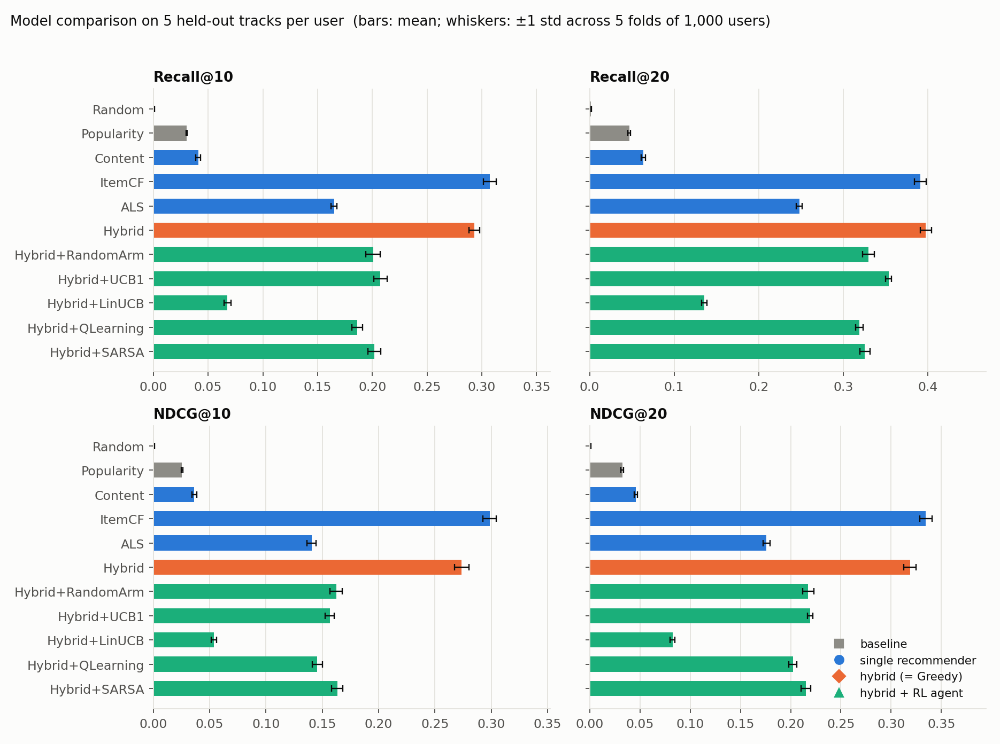
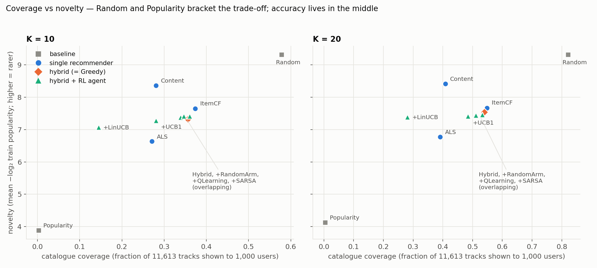
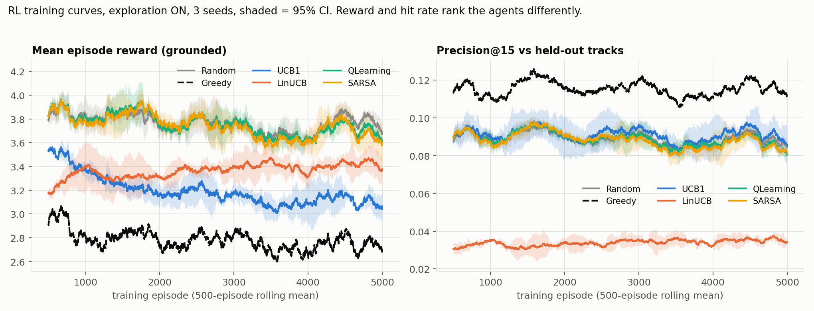
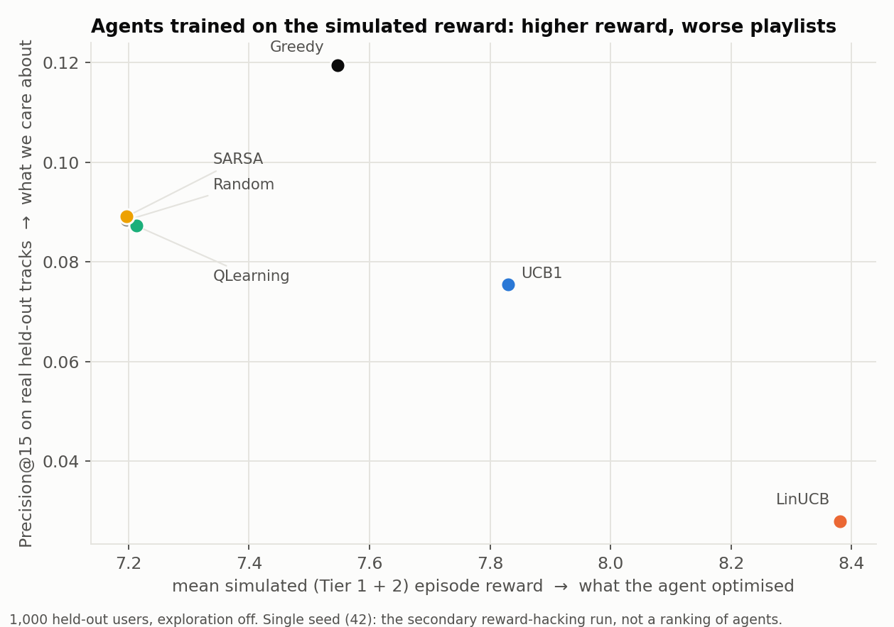

# Adaptive Hybrid Music Playlist Recommendation using Reinforcement Learning — Findings

*Generated by `report/build_findings.py` from `report/findings_template.md`. Every table, and every result
number quoted in the prose, is filled in from the CSVs under `results/`, so the report cannot drift from the data.
Each section names the file a claim traces to.*

## 0. Summary

1. **Personalised collaborative filtering does nearly all the work.** Item–item CF alone reaches Recall@20 {{M:ItemCF:20:recall}} and
   NDCG@20 {{M:ItemCF:20:ndcg}}; popularity reaches {{M:Popularity:20:recall}} and NDCG {{M:Popularity:20:ndcg}}. The RRF hybrid is a good *candidate
   generator* (candidate recall@100 = {{V:cand_recall}}) but not a better *ranker* than ItemCF (§5.1–5.2).
2. **The RL result is negative.** No learned agent (UCB1, LinUCB, Q-Learning, SARSA) beats the plain hybrid ranking (Greedy) on any
   accuracy metric, in any of the 5 evaluation folds, at K = 10 or 20. Against a uniformly random choice of content cluster
   (the fair control), Q-Learning is measurably *worse*, SARSA is at best on par, UCB1 is mixed (better on Recall@20, not on NDCG), and LinUCB is far worse (§5.3, §6.1).
3. **The reward and the quality we care about disagree.** Ranked by mean grounded reward, Greedy — the agent with the highest hit rate — comes
   fifth of six; SARSA and Random, whose hit rates are middling, lead (§6.2).
4. **LinUCB games the reward.** Trained on the simulated (content-similarity) reward it earns the highest reward of all six agents
   (+{{V:sim_linucb_reward_gain}} over Random) while its real hit rate falls to {{V:sim_linucb_frac_random}}× Random's (§6.3).
5. **Genre labels do not help** (§5.4): adding a 0.10-weight genre block changes Content NDCG by ≈ +0.001 and the Hybrid by nothing measurable.
6. **The data limits what any of this can show:** no timestamps, no skips, no sessions (§6.5). "Sequential" here means *the playlist the agent builds*.
7. **Two hyper-parameter choices were not independently validated:** ItemCF's k = 5 (chosen on the same hold-out used for evaluation) and
   LinUCB's α = 1.0 (never tuned) (§6.4).

---

## 1. System

```
Music_Info.csv (50,683 tracks)      User Listening History.csv (9.71M rows)
        └───────────── join on track_id ─────────────┘
   clean + merge duplicates → iterative k-core → 40,000-user subsample → re-core
        → 39,825 users × 11,613 tracks, 1,489,288 interactions, leave-5-out split
   content vectors (9 quantile-normalised audio features + 100-term TF-IDF tags)
   Popularity · Content · Item-item CF (k=5) · ALS (implicit, confidence-weighted)
        → NDCG-weighted Reciprocal Rank Fusion → ~88 candidates per user
   RL layer: agent picks one of 10 fixed global content clusters per step;
        the environment deterministically resolves it to the best unused candidate
        → 5–20-track playlist  →  evaluation (P/R/F1/NDCG/MAP/HR @10,20 + beyond-accuracy)  →  Streamlit demo
```

Code: `src/data_prep.py`, `src/features.py`, `src/recommenders/`, `src/rl/`, `src/evaluation/`, `src/playlist.py`, `app.py`.
The full build specification, including every amendment made along the way, is `docs/SPEC.md`.

---

## 2. Dataset analysis

### 2.1 Part A reproduced (Phase 0)

Every Part A number was recomputed from the raw files in Phase 0 (`results/eda/dataset_stats.json`, figures in `results/eda/figures/`).

{{T:parta}}

Every row matches the spec except the **playcount skew**. The spec quotes 46.31 (raw) and 2.11 (after `log1p`); Phase 0 reproduces
{{V:skew_raw}} and {{V:skew_log}}. pandas' adjusted estimator, scipy's biased and unbiased estimators all give the same value,
and neither a 99.99% winsorisation (10.95) nor per-track totals (69.28) gives 46.31, so the original figure could not be reproduced under any estimator
or aggregation we tried. The substantive claim is unaffected — playcount is extremely heavy-tailed and `log1p` removes most of the skew — and `docs/SPEC.md` B.11 now carries the reproduced values.
A second, smaller difference: B.14 says the top 10% of tracks hold 47.0% of interactions; we get **46.8% on the filtered core** (and 66.4% on the raw
catalogue). We take 47.0% to have been the core figure.

**Genre labels are unreliable** (B.5) — only 44.1% of tracks have one (55.9% missing) and, where present, it appears among the track's own tags 46.5% of the time overall:

{{T:genreagree}}

### 2.2 The join, in both directions

- **History → catalogue:** all 30,459 tracks in the listening history exist in `Music_Info.csv`; 0 history rows are unjoinable. Every interaction can be enriched with audio features and tags.
- **Catalogue → history:** **20,224 of 50,683 catalogue tracks (39.9%) have no listens at all.** They are invisible to collaborative filtering and reachable only content-side.
  In the system as built, *every* recommender operates on the 11,613-track interaction core, including the content recommender (which uses the core content matrix), so **these
  20,224 tracks — and every other non-core track — are never recommended.** The full-catalogue content matrix exists (`content_matrix.npz`), but exploiting it for cold-start items is not part of the evaluated system.

### 2.3 Filtering and what it costs

The raw matrix has density 0.0331% and a median user with 5 interactions — too few to profile, hold out 5 tracks, and run a 15-step episode (B.4). After iterative
k-core filtering (users ≥ 20 interactions, tracks ≥ 50 listeners; the threshold table is in the spec's B.4 and was not re-derived here), a seeded 40,000-user
subsample, and a re-run of the k-core to convergence with the track threshold rescaled to ≥ 17 (B.4 / Phase 1 task 5 — re-applying ≥ 50 to a population one-third the size
would have cost ~49% of the catalogue), the analysis population is (re-verified from `data/processed/` in Phase 9):

| | Raw | Analysis core | Share kept |
|---|---|---|---|
| Users | 962,037 | 39,825 | {{V:core_user_share}} |
| Tracks with history | 30,459 | 11,613 | {{V:core_item_share_of_history}} (of the catalogue: {{V:core_item_share_of_catalogue}}) |
| Interactions | 9,711,301 | 1,489,288 | {{V:core_interaction_share}} |
| Density | 0.0331% | 0.322% | {{V:density_gain}} denser |
| Distinct artists | — | 2,760 | |
| Tracks with tags | — | 98.8% | |

Train: 1,290,163 interactions; hold-out: 199,125 (exactly 5 per user × 39,825 users). **Consequence for interpretation:** every result below describes users with ≥ 20 listened
tracks (4.1% of users); nothing here says how the system would treat a cold-start listener.

---

## 3. Corrections to the original plan

### 3.1 Part B — what changed and where it shows up

| | Correction | Where evidenced |
|---|---|---|
| B.1 | "Sequential" reframed: the MDP is over the playlist the agent builds, not an observed listening order (no timestamps) | §6.5; `src/rl/environment.py` |
| B.2 | SVD/SVD++ dropped (no ratings, no negatives); ALS with confidence weighting via `implicit`; **no RMSE/MAE anywhere** | `src/recommenders/als_model.py`; guard tests in `tests/test_metrics.py` and `evaluate_all.py` |
| B.3 | User-based CF dropped (962,037² similarity matrix); item–item only | `src/recommenders/item_cf.py` |
| B.4 | Iterative k-core, then subsample; post-subsample track threshold rescaled 50 → 17 | §2.3; `config.py` |
| B.5 | Genre demoted from feature to ablation — and the ablation shows it does not matter | §5.4 |
| B.6 | No DQN (justification in §7.1) | — |
| B.7 | Two-level action space: 10 fixed global clusters, 162 × 10 Q-table; LinUCB at song level | §7.3 |
| B.8–B.10 | 9 duplicate pairs merged; `tempo = 0` / extreme durations dropped; `year = 1900` → null; `QuantileTransformer` instead of z-scoring; `loudness`, `key`, `mode`, `time_signature` dropped | `src/data_prep.py`, `src/features.py` |
| B.11 | Playcount → preference/confidence (`c_ui`) and per-user affinity (`aff_ui`); no min-max pseudo-ratings | `data/processed/*` |
| B.12 | Grounded reward (Tier 1) is the primary experiment; simulated reward (Tier 2) is declared and secondary | §6.3, §6.5 |
| B.13 | Candidate pool N = 100 (≈ 88 distinct); candidate recall@100 = {{V:cand_recall}} ≥ 0.40, so no widening was needed | §5.2 |
| B.14 | Rank-based fusion (RRF) instead of score blending | §5.2 |
| B.15 | Random per-user leave-5-out (no temporal split possible); ranking metrics at K = 10, 20; no rating-error metrics | §4.4 |
| B.16 | Mood-quadrant pre-filter, BPR, weighted-linear hybrid, `w_div` sweep: **deferred and not done** (Part F) | — |

### 3.2 Corrections made while building (disclosed, several post hoc)

These are changes to the specification made after seeing a result. They are listed so a reader can judge for themselves how much freedom the analysis had.

1. **Post-subsample track threshold ≥ 17, not ≥ 50** — the spec's B.4/Phase 1 task 5 and `config.py` document the reasoning (≥ 50 would cost ~49% of the catalogue).
2. **Phase 4 acceptance gate changed** after plain RRF failed it. The original criterion (Hybrid NDCG@20 ≥ the best single model) was dropped and Phase 4 was re-scoped to *candidate generation* (recall@100 ≥ 0.40).
   Unweighted RRF scored NDCG@20 {{V:unw_rrf_ndcg}}; NDCG-weighting the RRF terms recovered most of the gap ({{V:w_rrf_ndcg}}) but still trails ItemCF alone ({{V:itemcf_ndcg_p4}}).
3. **Phase 5: artist cap hard filter → soft penalty.** With a hard cap the repetition penalty could never be incurred, removing the credit-assignment signal that justifies RL over a bandit.
4. **Phase 5/6: per-episode KMeans → fixed global clusters** (`models/global_song_clusters.npy`). Arm identity must mean the same thing across episodes for any agent to learn anything about arms.
5. **`w_rel` raised 1.0 → 3.0 after the first Phase 6 run.** In that run the diversity term contributed as much reward as relevance or more (for the Random agent: relevance 0.121 vs
   0.3 × 0.627 = 0.188 per step; `results/phase6/diagnosis/reward_decomposition.csv`, `arm_distribution.csv`). This is a post-hoc reward change made after seeing agents fail to beat Random.
6. **First run superseded.** It used 20,000 episodes × 5 seeds, `w_rel = 1.0`, an ε-greedy bandit and a UCB1 that put 100% of its pulls on one arm (`results/phase6/diagnosis/arm_distribution.csv`).
   The rerun uses 5,000 episodes × 3 seeds, canonical UCB1 (bonus √(2 ln t / nₐ)), and drops the ε-greedy bandit as redundant with UCB1. **Seeds are 3, not the ≥ 5 the spec asks for**, so cross-seed spreads are rough.
   The `results/phase6/diagnosis/` CSVs come from the first run and are cited only for point 5.
7. **LinUCB's α grid search was dropped** for cost (a ~64-hour projection that was later traced to BLAS thread oversubscription and fixed; LinUCB then ran at ~0.02 s/episode). The grid was affordable in hindsight and was not re-instated (§6.4).
8. **Phase 6 acceptance gate amended after it failed.** Original: "all learned agents beat Random." Only UCB1 exceeded Random on Precision@15 in the first grounded run,
   by 0.0009 against a cross-seed std of 0.0041 — a tie. It was replaced with: all agents on `BaseAgent`, all plateau, Q-Learning and SARSA learn distinct policies, and the comparison is reported against both Random and Greedy.
   The reason is that relevance fires on only ~1.3–1.8 of 15 steps (§5.3), so a gate demanding a positive result was an assumed conclusion rather than a test. The amendment is post hoc and recorded as such in `docs/SPEC.md`.
9. **"5 seeds" in Phase 7 became 5 evaluation folds** (§4.4), because the non-RL models are deterministic.
10. **Part A discrepancies** in the playcount skew and the top-10% share (§2.1).

---

## 4. Methods (brief)

### 4.1 Recommenders (Phase 3–4)
Content: cosine between an affinity-weighted train-only user profile and the content matrix (audio 0.45 / tags 0.55). ItemCF: cosine on the confidence matrix, top-5 neighbours per item, score Σ sim · aff.
ALS: grid over factors {32, 64, 128} × regularisation {0.01, 0.05, 0.1} on an internal validation slice carved out of *train* (`models/als_grid_search.csv`); the best validation NDCG@20 was at **factors = 128, regularisation = 0.1** (not the spec's default 64 / 0.05), refit on all train. The winner sits on the edge of the grid (128 is the largest factor count tried), so ALS may be under-tuned (§6.4).
Popularity: distinct train listeners. Hybrid: pool 50 ItemCF + 30 ALS + 15 Content + 5 Popularity, dedupe, re-rank with NDCG-weighted RRF (weights = each model's solo NDCG@20, normalised).

### 4.2 Environment and reward (Phase 5)
State: (energy bucket of last 3 tracks, valence bucket, diversity level, artist-near-cap flag, position bucket) → 162 states. Action: one of 10 global content clusters; the environment picks the best-hybrid-score unused candidate in it.
Step reward `r = 3.0·rel + 0.3·(1 − max cosine to the playlist so far) − 0.5·[artist already ≥ 2×] − 1.0·[duplicate]`.
**Grounded (primary):** `rel` = the user's own normalised affinity if the track is one of their 5 held-out tracks, else 0. **Simulated (secondary, single seed):** for non-held-out tracks `rel` = 0.3 × cosine(user profile, track) — a
*modelling assumption*, not observed feedback. {{T:phase5}}

### 4.3 Agents (Phase 6)
Random, Greedy (always the top hybrid score), UCB1 (state-free), LinUCB (song-level, α = 1.0, Sherman–Morrison updates), tabular Q-Learning and SARSA (α = 0.1, γ = 0.9, ε 1.0 → 0.05). All six subclass `BaseAgent`.
5,000 training episodes × 3 seeds on one fixed 5,000-user curriculum shared by every agent. **Table of record: exploration disabled** (ε = 0; UCB1 without bonus; LinUCB α = 0), 1,000 users not in the curriculum.

### 4.4 Evaluation protocol (Phase 7)
- **Population.** 5,000 users drawn at random from those *not* in the RL training curriculum, split into 5 disjoint folds of 1,000. Every configuration is scored on the same folds.
- **"Seeds" = folds.** Non-RL models are deterministic, so the variability that matters is *which users are scored*. Reported: mean ± std across the 5 folds (Random uses one seed per fold). For RL rows each fold value additionally averages the 3 trained checkpoints; the between-checkpoint spread is in `results/phase7/rl_by_train_seed.csv`.
- **RL playlists** are generated with `playlist_length = K` (10 and 20), exploration off. Agents were trained at length 15, so K ≠ 15 is a mild distribution shift.
- **Greedy ≡ Hybrid.** The Greedy agent's playlist equals the Hybrid pool's top-K for 5,000/5,000 users at both K (`results/phase7/greedy_equals_hybrid.csv`), so it is reported once.
- **Leakage assertions** (they raise on failure; all passed, `results/phase7/leakage_checks.json`): eval users disjoint from the RL curriculum; no user's hold-out track in their train row; no recommended item ever in the user's train set;
  200 sampled user profiles reproduce exactly from train rows only — with a power check that all 200 *would* change if hold-out rows were included.
- **Sanity check against earlier phases.** On this fresh user sample ItemCF@20 gives NDCG {{M:ItemCF:20:ndcg}} and Hybrid Recall@20 {{M:Hybrid:20:recall}}, matching Phase 3/4's {{V:itemcf_ndcg_p4}} and {{V:w_rrf_recall}} on all users.
- **Valid metrics only:** Precision, Recall, F1, NDCG, MAP, HitRate @K; coverage, intra-list diversity (1 − mean pairwise content cosine), novelty (mean −log₂ train popularity), artist entropy, Gini. No RMSE or MAE exists in any output.

---

## 5. Results

### 5.1 Model comparison

Mean ± std across the 5 folds of 1,000 users (`results/final_comparison.csv`; wide form `results/phase7/final_comparison_wide.csv`). Each user has 5 held-out tracks, so P@10 ≤ 0.5 and P@20 ≤ 0.25.
`Random (catalogue)` draws uniformly from the 11,613-track catalogue minus the user's train tracks; `Hybrid+RandomArm` is the RL *control* (a random content cluster at each step, inside the hybrid pool) and is a different, much stronger baseline.

**K = 10**

{{T:cmp10}}

**K = 20**

{{T:cmp20}}



Reading it: ItemCF ≫ ALS ≫ Content > Popularity ≫ Random (catalogue). The Hybrid's hit rate at K = 20 ({{MS:Hybrid:20:hit_rate}}) is the highest of all configurations, but ItemCF wins on every rank-sensitive metric (NDCG, MAP) and on
every metric at K = 10; the Hybrid leads only on the count-based K = 20 metrics, by about one across-fold std. Every RL configuration sits below the Hybrid.

**Popularity is a weak baseline here, not a hard one.** The spec anticipated that a popularity-heavy list would "score well on Precision@K and terribly on novelty and coverage" because the top 10% of tracks hold ~47% of interactions. On this
dense core the first half did not happen: Popularity's P@10 is {{MS:Popularity:10:precision}} versus {{MS:ItemCF:10:precision}} for ItemCF, and its coverage is {{MS:Popularity:10:catalog_coverage}} with the lowest novelty of any configuration. Popularity's RRF weight is small (5.6%) because its solo NDCG@20 is low.

### 5.2 Beyond accuracy, and the candidate generator

**K = 10**

{{T:beyond10}}

**K = 20**

{{T:beyond20}}



Coverage is measured over the 11,613-track core for the 1,000 users of a fold, so its absolute level depends on fold size; it is comparable across rows, not across studies. Random (catalogue) dominates diversity, coverage and novelty and is useless at accuracy.
Random-arm, Q-Learning, SARSA and LinUCB produce *more diverse, more artist-varied* lists than the Hybrid (ILD ≈ 0.88–0.90 vs 0.76 at K = 10; UCB1, a fixed cluster, does not) at the price of accuracy — which is what their reward pays for (§6.2). LinUCB is the outlier: the lowest coverage and the highest Gini of any personalised configuration.

**Phase 4 finding — ALS, Content and Popularity are largely redundant with ItemCF on this dataset, not complementary to it.** ItemCF alone reaches candidate recall@100 = {{V:itemcf_only_cand_recall}}; pooling all four models reaches {{V:cand_recall}} — a
0.001 gain for three extra models. This is a property of the filtered 39,825-user × 11,613-item subset (0.322% dense), where item co-occurrence already captures most recoverable signal; it is not a general claim that hybrids are redundant. It is also **not independent of the k = 5 choice** (§6.4).

{{T:phase4}}

{{T:fusion}}

**ItemCF neighbour sweep (sensitivity analysis, not tuning).** Recall@20, NDCG@20 and Coverage@20 all peak at k = 5 and fall for larger k; coverage *rising* as k falls rules out popularity concentration as the explanation.
This was run on the same hold-out used for evaluation, so it shows how sensitive ItemCF is to k, not that k was optimised (§6.4).

{{T:ksweep}}

### 5.3 The RL agents

**Table of record** — every agent frozen with exploration disabled, 1,000 users outside the training curriculum, 3 training seeds, mean ± std across training seeds (`results/phase6/grounded/final_eval_no_exploration.csv`):

{{T:record}}

On a 15-track playlist a random cluster choice already lands {{V:hits_random}} of the 5 held-out tracks and Greedy {{V:hits_greedy}}: **the relevance term can fire on only about 1.3–1.8 of 15 steps.** The signal an agent learns from is that sparse.

The same conclusion holds on the larger Phase 7 sample (5 folds × 1,000 users, K = 10 and 20). Paired differences per fold, RL agent minus reference:

{{T:paired}}

- **Nothing beats Greedy.** Every learned agent is worse than the Hybrid ranking in 5 of 5 folds at both K on both metrics; at K = 20 the Recall deficits range from {{V:ucb_recall20_vs_greedy}} (UCB1) to {{V:linucb_recall20_vs_greedy}} (LinUCB).
- **Against the fair control (Random arm):** Q-Learning is never better than the control in any fold, at either K, on either metric (Recall@20 {{V:ql_recall20_vs_rand}}, NDCG@20 {{V:ql_ndcg20_vs_rand}}). SARSA is at best on par: {{V:sarsa_recall10_vs_rand}} Recall@10 (3/5 folds better) but {{V:sarsa_recall20_vs_rand}} Recall@20 (0/5).
  LinUCB is far worse. UCB1 looks better on Recall@20 ({{V:ucb_recall20_vs_rand}}) but not on NDCG@20 ({{V:ucb_ndcg20_vs_rand}}), and — see below — that depends on which arm each seed happens to select.
- **A frozen UCB1 asks for one fixed cluster at every step, then falls back to the hybrid ranking.** With the bonus removed it plays `argmax q`: {{V:ucb_arms}}. The arms' estimated values are practically tied (q between {{V:ucb_q_range}} across all ten arms), so which arm wins is close to noise;
  seeds 43 and 44 happen to pick the same one, hence their identical numbers. That cluster holds a median of only {{V:ucb_pool_median}} of a user's ~88 pool candidates (≥ 15 for just {{V:ucb_share_ge15}} of users); once they are used up the environment falls back to the best remaining candidate by hybrid score,
  so the rest of the playlist is Greedy-style. UCB1's accuracy sits between Random-arm and Greedy (P@15 {{TRM:UCB1:precision_at_15}} vs {{TRM:Random:precision_at_15}} and {{TRM:Greedy:precision_at_15}}), which is consistent with that fallback contributing rather than with learned arm values; the mechanism follows from the environment's code and the pool statistics
  (`results/phase7/ucb1_frozen_arm.csv`) but was not isolated by an ablation. Either way it is not evidence that UCB1 learned anything, and its edge is seed-dependent — NDCG@20 by training seed: {{V:ucb_seed42}}, {{V:ucb_seed43}}, {{V:ucb_seed44}}, against {{M:Hybrid+RandomArm:20:ndcg}} for the Random-arm control.

**Between-checkpoint spread** (NDCG@20, `results/phase7/rl_by_train_seed.csv`):

{{T:seedspread}}

**Q-Learning vs SARSA.** The two learn distinct tables: their greedy actions differ in {{V:qs_diff_states}} of 162 states (seeds 42, 43, 44). That count includes states rarely or never visited, whose greedy action is close to arbitrary, so it should not be read as 40–50% genuinely different behaviour.
SARSA scores slightly higher than Q-Learning on hit rate in every seed (P@15 0.090 vs 0.084 in the table of record), but Q-Learning is below Random and SARSA within 0.002 of it.

**Convergence.** All four learned agents pass the plateau test (rolling-mean reward stops changing; `results/phase6/grounded/convergence.csv`), for every seed. Read this narrowly: the curves are flat from early on *because the agents track Random*,
not because they reached a good policy (`results/figures/rl_learning_curves.png`). Averaged over 5,000 episodes × 15 steps there are only ~{{V:pool_steps_per_cell}} updates per Q-table cell.



### 5.4 Ablations

**Genre block (B.5).** A one-hot genre block (UNK for the 56% missing) at weight 0.10, the spec's ceiling, on top of the audio/tag blocks. The no-genre rebuild is asserted to reproduce the Phase 2 content matrix exactly. The RL agents were *not* retrained
(`results/phase7/ablation_genre.csv`):

{{T:genre}}

Genre adds ≈ +0.001 NDCG to the Content recommender (consistent in sign but tiny: paired std ≈ 0.0005) and nothing measurable to the Hybrid or to candidate recall. B.5's decision to demote genre is confirmed — though the effect is so small that "genre is harmless at 0.10" is as accurate a summary as "genre does not help".

**Grounded-only vs grounded + simulated reward (B.12).** Every agent trained with each reward, frozen, and scored on the same 1,000 held-out users under both rewards and on real hit rate (`results/phase7/ablation_reward.csv`).
The grounded rows use 3 seeds; the simulated rows are the single-seed secondary run, so read the simulated rows as a demonstration, not a ranking.

{{T:rewardabl}}

---

## 6. Limitations

### 6.1 The RL result is negative, and we can only partly say why
**What is established:** no learned agent improves on the hybrid ranking it is given (§5.3); Q-Learning is slightly worse than picking a random cluster and SARSA at best on par with it; the differences from Random-arm are small enough that the headline is "they did not learn something useful", not "they learned something harmful" — except LinUCB, which is harmful (§6.3).

**Why (hypotheses — none was isolated by an ablation):**
1. *Sparse reward.* Relevance fires on ~1.3–1.8 of 15 steps, in ~88-candidate pools that contain on average 2.8 of the user's 5 held-out tracks (candidate recall@100 = {{V:cand_recall}}); the diversity and repeat terms are far denser and dominate what is learnable.
2. *The tabular state carries no information about which cluster contains this user's hits.* It encodes only energy/valence of the last three tracks, diversity, artist flag and position, so Q(s, a) averages over all users — which would explain why state-free UCB1 and the stateful agents look alike.
3. *A strong prior.* Greedy simply follows the ItemCF-dominated ranking. An agent choosing among 10 coarse content clusters must both find and exceed that ordering, and the cluster is a much blunter action than the ranking.
4. *A pool ceiling.* All agents reorder a ~88-track pool; the best possible Recall is bounded by candidate recall@100.
5. *Little training and no tuning:* 5,000 episodes, 3 seeds, untuned Q-Learning/SARSA hyper-parameters.

**What would change it (untested):** denser feedback (real skips and dwell time); longer playlists; a state that includes hybrid-score or affinity features; a reward whose weights were swept rather than set a priori (the deferred `w_div` sweep); more seeds and tuned learning rates. None of this is claimed to work.
"RL does not help *in this setup*" is the defensible statement; "RL cannot help" is not.

### 6.2 Reward and quality disagree (the reward/quality anticorrelation)
The agent with the best hit rate has the second-lowest reward. Decomposing the table-of-record reward into its three terms (`results/phase7/ablation_reward.csv`; relevance term = reward − diversity − repeat):

{{T:decomp}}

Greedy collects the most relevance ({{V:greedy_rel}} vs Random's {{V:random_rel}}) but it repeats an artist on {{V:greedy_repeat_pct}} of steps (Random: {{V:random_repeat_pct}}), paying a repeat penalty of {{V:greedy_repeat_pen}} (vs {{V:random_repeat_pen}}), and its picks are
less diverse (diversity term {{V:greedy_div_term}} vs {{V:random_div_term}}); net, its reward is lower. Across the six agents the Spearman correlation between grounded reward and Precision@15 is {{V:rho_gr_reward}} — negative, but with n = 6 this is descriptive, not a significance claim.

Part of this is by design: the reward deliberately prices diversity and artist repetition, and hit rate measures relevance alone, so the two need not agree. The finding is that **at the weights used (`w_rel = 3.0`, `w_div = 0.3`, `w_rep = 0.5`, set a priori and raised once post hoc) the beyond-accuracy terms outweigh
relevance enough that maximising reward would move a system away from what the hold-out measures.** Reward, not hit rate, is what an RL agent optimises, so this is a design problem in the reward, not only a diagnostic curiosity. The `w_div` sensitivity sweep that would map the trade-off is deferred (Part F) and was not run.

### 6.3 LinUCB's reward-hacking discovery
LinUCB has the *lowest* hit rate of all agents under both reward modes, while its reward is high:

- **Grounded reward (primary run).** LinUCB's P@15 is {{TRM:LinUCB:precision_at_15}} — {{V:linucb_p15_frac_random}}× Random's and {{V:linucb_p15_frac_greedy}}× Greedy's — yet its mean reward ({{TRM:LinUCB:mean_reward}}) beats Greedy's ({{TRM:Greedy:mean_reward}}). It earns it from the cost terms:
  the highest diversity term ({{V:linucb_div_term}}) and almost no artist repetition ({{V:linucb_repeat_pct}} of steps, penalty {{V:linucb_repeat_pen}}), with a relevance term of only {{V:linucb_rel}}.
- **Simulated reward (secondary, single seed).** Trained with the content-similarity term, LinUCB earns the highest simulated reward of all six agents ({{AB:grounded_simulated:LinUCB:sim_reward_mean}} vs Random's {{AB:grounded_simulated:Random:sim_reward_mean}}, +{{V:sim_linucb_reward_gain}}) while its Precision@15 falls to
  {{AB:grounded_simulated:LinUCB:precision_at_15_mean}} ({{V:sim_linucb_frac_random}}× Random's). It collects {{V:sim_linucb_tier2_ratio}} Random's simulated relevance per step without landing real held-out tracks. Across agents trained this way, the Spearman correlation between simulated reward and real Precision@15 is {{V:rho_sim_sim}}:

{{T:corr}}



The same pattern appeared in the first, superseded run (LinUCB the highest simulated reward with about a third of Random's hit rate; recorded in `docs/SPEC.md` Phase 6) and was the reason the simulated reward was demoted to a secondary experiment. **Why it is plausible** (an inference from
the Content recommender's weakness, not a tested mechanism): content similarity to a user's profile barely predicts what they actually played — the Content recommender's NDCG@20 is {{M:Content:20:ndcg}} against ItemCF's {{M:ItemCF:20:ndcg}} — so rewarding it rewards something nearly uncorrelated with real listening,
and a high-capacity learner with the user profile in its context (LinUCB) is the agent best placed to exploit it. **Caveats:** the simulated run is one seed; LinUCB's α is untuned (§6.4); and Q-Learning and SARSA show no comparable effect.

### 6.4 Hyper-parameter caveats: k = 5 and α = 1.0
**ItemCF k = 5 was chosen on the evaluation hold-out.** The sweep over k ∈ {2, 5, 10, 15, 20, 30, 40, 50} used the same 5-per-user hold-out on which every model in this report is scored, and the RRF weights (each model's solo NDCG@20) were read off the same hold-out. Reported ItemCF and Hybrid numbers are
therefore optimistically biased by an unknown amount. Its size is bounded by the sweep itself: k = 5 wins by {{V:k_gap_runnerup}} Recall@20 over the runner-up (k = 10) and by {{V:k_gap_worst}} over k = 50, against an ItemCF-over-ALS gap of {{V:itemcf_minus_als_recall20}}, so the *ordering* of models is not in doubt but the *level* of ItemCF is. A separate
validation split would have been the rigorous way to select k; ALS's grid, by contrast, did use a validation slice carved from train. Because k = 5 was tuned for ItemCF, ItemCF's dominance over the other recommenders (§5.2) is not independent of it.

**LinUCB α = 1.0 was fixed, not tuned.** The planned grid α ∈ {0.5, 1.0, 2.0} was dropped for cost. Any LinUCB conclusion here — including the reward hacking above — is at one untuned α, on a single shared linear model over a 223-dimensional context, for a reward that depends non-linearly on playlist history.
The Q-Learning/SARSA learning rate, discount and ε-schedule were likewise not tuned. **ALS's grid winner (factors = 128) is at the grid's upper edge**, so ALS may be under-tuned too, which would flatter ItemCF's lead. LinUCB's α would have been affordable to sweep after the BLAS fix; it is an open item.

### 6.5 What the data cannot support: no timestamps, no skips
- **No timestamps or sessions → no observed sequence and no temporal split.** The split is a random per-user leave-5-out. The "sequential" element is the *playlist the agent constructs*: transitions come from the agent's own previous choices, and the diversity/repeat terms make an early choice matter later. Nothing validates the ordering against how anyone actually listens.
- **No skip, dwell or negative feedback.** `playcount` is an implicit-feedback count with a floor of 1. A track that is not in a user's history is *unobserved*, not disliked, so a "miss" against the hold-out is not evidence of a bad recommendation. We did not simulate skips.
- **No demographics or context**, and playcount is aggregated over an unknown window.
- **Precisely which parts of the reward are observed.** In the table of record only the *relevance* term is grounded: 3.0 × the user's own normalised playcount affinity, and only for one of their 5 held-out tracks. The diversity, artist-repeat and duplicate terms are deterministic functions of content vectors and artist names — design preferences, not user feedback. The
  **Tier-2 content-similarity term is a declared simulator** ("we assume a user's affinity for an unseen track is proportional to its content similarity to their profile"); it appears only in the single-seed secondary run and never in any table of record.

### 6.6 Other limitations
- **Scope of validity.** 39,825 users with ≥ 20 listens (4.1% of users) and 11,613 tracks; nothing here speaks to cold-start users or the 20,224 orphan tracks (§2.2).
- **Post-hoc amendments** (§3.2) — including the Phase 6 gate, the `w_rel` change and the 5-fold reinterpretation of "5 seeds" — mean the analysis had researcher freedom that a pre-registered design would not.
- **Seeds and spread.** RL rows use 3 training seeds (spec: ≥ 5). The reported std across folds measures user-sampling variability only; training-seed variability is reported separately (§5.3). UCB1's outcome depends on which near-tied arm each seed lands on and on the environment's greedy fallback (§5.3).
- **K ≠ 15 for RL evaluation** in Phase 7 (agents trained at 15); the Phase 6 table of record is at K = 15.
- **Beyond-accuracy metrics** depend on fold size (coverage over 1,000 users) and on the content matrix used to define similarity.
- **Preview links** in the demo come from Spotify URLs stored in the dataset; some may no longer resolve.
- **Deferred, not done:** BPR, the weighted-linear hybrid, the mood-quadrant filter and the `w_div` sweep (Part F). DQN is documented (§7.1) and deliberately never implemented.

---

## 7. Design justifications

### 7.1 Why tabular RL and not DQN (B.6)
(1) The environment is fully known and deterministic — transitions are the agent's own playlist edits — so there is no unknown dynamics model to approximate. (2) The horizon is short (10–20 steps), and deep credit assignment over long horizons is what deep RL buys. (3) Function approximation is needed only when the state space is too large to tabulate; the discretised state here has 162 states.
(4) DQN over ~100 discrete actions with a sparse offline reward would be unstable and cost more in replay-buffer debugging than it would demonstrate. DQN *would* be warranted with continuous or very high-dimensional state, an action space in the thousands, or a learned stochastic user simulator. The negative RL result is not evidence for DQN: the diagnosis in §6.1 points at reward density and state information, not function-approximation capacity.

### 7.2 Why ALS with confidence, not SVD++ (B.2)
SVD++ is defined for explicit ratings with observed negatives; `playcount` has a floor of 1 and no negatives, and applying it would require inventing a rating scale and would invite the standard, invalid RMSE evaluation. ALS with confidence weighting (Hu, Koren & Volinsky 2008) is the implicit-feedback member of the same latent-factor family: preference is binary, confidence grows with log playcount. Ranking metrics are the only valid evaluation.

### 7.3 Why a two-level action space (B.7)
A flat action of "pick one of 100 candidate songs" has no stable meaning: `Q(s, song_47)` refers to a different track for every user and every step, so a tabular Q-table over it transfers nothing. Level 1 (RL) therefore chooses one of 10 fixed global content clusters, so an arm means the same thing in every episode; level 2 deterministically takes the best unused candidate in it.
The clusters must be global rather than refit per episode for the same reason (§3.2 point 4). The cost is that the action is coarser than the ranking, which is one of the hypotheses in §6.1.

---

## 8. Answers to the viva questions the results settle (Part E)
- **Where is the sequence in your data?** Nowhere; there are no timestamps. It is in the playlist the agent constructs (§6.5).
- **Is the simulated reward circular?** Partly — and it is demonstrably gameable (§6.3). That is why the table of record is grounded-only and the simulated run is a single-seed secondary experiment.
- **Why not SVD++?** No ratings (§7.2).
- **Why discard 96% of your users?** A 15/5 split and a 15-step episode need ≥ 20 interactions per user; the median user has 5 (§2.3). Density rises {{V:density_gain}}.
- **Does the RL layer beat the hybrid on its own?** No. Every learned agent is below the plain hybrid ranking in 5/5 folds at both K, and Q-Learning is below a random cluster choice (§5.3). Likely reasons and what could change it are in §6.1.

---

## 9. Reproducing this report

```
python -m src.eda                                   # Phase 0   -> results/eda/
python -m src.data_prep && python -m src.features   # Phases 1-2 -> data/processed/
python -m src.recommenders.popularity && python -m src.recommenders.content && python -m src.recommenders.item_cf
python -m src.recommenders.als_model && python -m src.recommenders.hybrid   # Phases 3-4 -> models/, data/processed/candidates.parquet
python -m src.rl.fit_global_clusters                # Phase 5 prerequisite
python -m src.rl.train                              # Phase 6 (grounded; 3 seeds)   ->  models/rl/grounded, results/rl_curves_grounded.csv
python -m src.rl.evaluate_phase6_final              # Phase 6 table of record
python -m src.rl.train grounded_simulated           # secondary single-seed run
python -m src.evaluation.rl_playlists && python -m src.evaluation.evaluate_all       # Phase 7
python -m src.evaluation.ablation_genre && python -m src.evaluation.ablation_reward
python -m src.evaluation.figures
streamlit run app.py                                # Phase 8
python report/build_findings.py                     # this file
```

`pytest` runs the unit tests (metrics, environment, agents, playlist service, and the headless Streamlit app).

| Claim | Source |
|---|---|
| Part A statistics, join analysis | `results/eda/dataset_stats.json` |
| ItemCF k sweep | `results/phase3/item_cf_k_sweep.csv` |
| Fusion variants, candidate recall | `results/phase4/fusion_comparison.csv`, `phase4_metrics.csv` |
| Random-policy sanity run | `results/phase5/random_policy_summary.csv` |
| Phase 6 table of record, convergence, Q/SARSA policies | `results/phase6/grounded/*.csv` |
| Main comparison (all metrics, mean ± std) | `results/final_comparison.csv`, `results/phase7/per_fold_metrics.csv` |
| Ablations, reward decomposition, correlations | `results/phase7/ablation_*.csv`, `reward_vs_quality_correlation.csv` |
| Leakage checks | `results/phase7/leakage_checks.json` |
| Figures | `results/figures/` |
